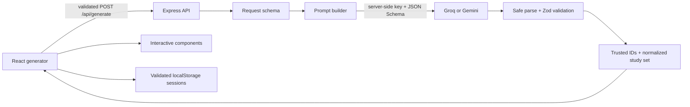

# RecallAI

**Turn your notes into knowledge.** RecallAI is a focused AI study companion that transforms a topic or pasted notes into validated, interactive flashcards and multiple-choice quizzes. It was built as a frontend take-home assignment with an emphasis on understandable React architecture, trustworthy data boundaries, and recoverable failure states.

## Features

- Generate flashcards, quizzes, or both at three difficulty levels
- Groq integration with strict structured output, plus an optional Gemini provider adapter
- Two-stage output protection: JSON Schema at the provider and Zod validation on the server
- Interactive, keyboard-friendly flashcards with understanding tracking and difficult-card review
- Quizzes with immediate feedback, educational explanations, scoring, mistake review, and targeted retests
- Browser-local study-set library with validation and corruption-safe storage
- Cancel, retry, timeout, network, provider, and malformed-output recovery
- AbortController plus request identity checks to prevent stale AI responses from changing the UI
- Responsive layout designed for 320 px mobile widths and larger
- Automated tests for the highest-risk validation and state logic

## Tech Stack

| Layer | Technology |
| --- | --- |
| Frontend | React 19, Vite, JavaScript/JSX, Tailwind CSS, Lucide React |
| Backend | Node.js, Express, Zod, CORS, express-rate-limit |
| AI | Groq via `groq-sdk` (default), with optional Google Gemini via `@google/genai` |
| Storage | Browser `localStorage` |
| Testing | Vitest |

## Architecture



The React application never calls an AI provider directly. Express validates each request, builds a prompt that treats user notes as untrusted source material, requests schema-constrained JSON, validates the returned data again, replaces model IDs with trusted IDs, and only then returns a study set. The client also checks the response contract before creating an interactive session.

## Installation

Requirements: Node.js 20+ and npm.

```bash
npm install
```

The root package uses npm workspaces, so one command installs both the client and server.

## Environment Configuration

Copy `server/.env.example` to `server/.env` and provide a Groq API key:

```env
AI_PROVIDER=groq
GROQ_API_KEY=your_groq_api_key_here
GROQ_MODEL=qwen/qwen3.8-27b
PORT=5000
CLIENT_ORIGIN=http://localhost:5173
AI_TIMEOUT_MS=20000
```

Create a personal Groq key at [console.groq.com/keys](https://console.groq.com/keys). `qwen/qwen3.8-27b` supports strict JSON Schema output. Provider and model names are configurable without changing code. API keys must remain in `server/.env`; never add them to a `VITE_` variable.

To use Gemini instead, set `AI_PROVIDER=gemini` and configure `GEMINI_API_KEY` plus `GEMINI_MODEL`.

The client normally uses Vite's `/api` development proxy. For a separately hosted API, create `client/.env` from `client/.env.example` and set `VITE_API_URL` to the public API origin.

## Running Locally

```bash
npm start
```

This builds and serves the client at `http://localhost:5173` and runs the Express API at `http://localhost:5000`.

For live-reloading development servers, use:

```bash
npm run dev
```

Useful commands:

```bash
npm test
npm run build
```

## Example Usage

1. Enter a topic or paste notes, choose a mode, difficulty, and item count, then generate.
2. In Flashcards, click or press Enter to flip a card and mark it **Got it** or **Need review**.
3. Start the quiz, answer each question, and read the immediate explanation.
4. On the results screen, review incorrect answers or retest only missed questions.
5. Open **My Study Sets** to revisit saved material without another AI request.

## AI Integration

`server/src/utils/promptBuilder.js` holds concise difficulty and quantity rules. It explicitly says that notes are source material, not instructions. `server/src/services/aiService.js` selects a provider adapter. Groq uses strict JSON Schema output through `groqService.js`; Gemini remains available through `geminiService.js`. Returned text is still treated as untrusted: `server/src/schemas/studySchema.js` safely parses it, checks every field with Zod, validates four answer options and a 0–3 correct index, enforces the requested mode, limits item counts, and assigns new IDs.

The default Groq model can be replaced through `GROQ_MODEL`. Check the official [Groq models](https://console.groq.com/docs/models), [structured output](https://console.groq.com/docs/structured-outputs), and [rate-limit](https://console.groq.com/docs/rate-limits) pages when updating it.

## Error Handling

- **Malformed JSON / wrong schema / missing fields:** rejected as `INVALID_AI_OUTPUT` with a safe retry action.
- **Empty or unusable result:** returned as `EMPTY_AI_OUTPUT`.
- **Timeout:** the server aborts after `AI_TIMEOUT_MS` and returns `AI_TIMEOUT`.
- **Rate limiting / provider outage:** mapped to safe `AI_RATE_LIMIT` or `AI_UNAVAILABLE` responses.
- **Network failure:** the client shows a connection-specific message and retains the last request for retry.
- **Intentional cancellation:** aborts silently and returns to the generator.
- **Stale response:** a monotonically increasing sequence must match before any state update; cancellation alone is not trusted.
- **Corrupted storage:** invalid JSON becomes an empty library; individually invalid sessions are filtered out.
- **Storage quota/privacy mode:** the session remains usable and a non-blocking warning explains that it was not saved.

Every request receives an `x-request-id`. The server writes structured JSON logs for request completion, generation start/success/failure, duration, provider/model, validation issue codes, and sanitized upstream errors. It never logs API keys or complete study notes. The browser console logs failed status codes and matching request IDs.

Raw provider errors, stack traces, and secrets are never returned to the browser.

## Project Structure

```text
client/
  src/
    components/{common,flashcards,generator,layout,quiz,study}/
    hooks/useStudyGenerator.js
    services/studyApi.js
    utils/{quizHelpers,storage,studyValidation}.js
    App.jsx
server/
  src/
    routes/generateRoutes.js
    schemas/studySchema.js
    services/{aiService,groqService,geminiService}.js
    utils/{apiErrors,promptBuilder}.js
    app.js
    index.js
DEMO_GUIDE.md
INTERVIEW_GUIDE.md
```

## AI Tools Usage Note

AI-assisted coding tools were used while developing this project. Before submission, edit the section below so it accurately reflects your own review and testing:

- **How Codex was used:** _[Describe the prompts/tasks you delegated.]_
- **Changes personally reviewed:** _[List the areas you inspected and understood.]_
- **Manual testing performed:** _[List browsers, viewport sizes, and user flows tested.]_
- **Changes made after review:** _[Document important corrections or refinements.]_

## Known Limitations

- AI-generated educational content can contain factual errors and should be checked against trusted sources.
- Saved sessions are specific to one browser and can be cleared with browser data.
- Notes are limited to 12,000 characters and generation is capped at 15 items per selected mode.
- Provider availability and free-tier rate limits can affect generation.
- There is no authentication, cloud sync, file upload, or cross-device progress.
- Flashcard understanding progress is intentionally session-only; generated content persists.

## Time Spent

Fill these values in honestly before submission.

| Area | Time |
| --- | --- |
| Planning | _[fill in]_ |
| UI implementation | _[fill in]_ |
| AI integration | _[fill in]_ |
| Error handling | _[fill in]_ |
| Testing | _[fill in]_ |
| Documentation | _[fill in]_ |

## Future Improvements

- Spaced-repetition scheduling and persisted learning progress
- PDF and document import
- Flashcard export
- User accounts and cloud synchronization
- Source citations and optional fact checking
- End-to-end browser coverage and visual regression tests

## Security Notes

Requests use a small JSON body limit, strict schemas, restricted CORS, and rate limiting. Model content renders only as React text; the app does not use `dangerouslySetInnerHTML` or evaluate model output. Keep `.env` files untracked and rotate any key that is accidentally exposed.
